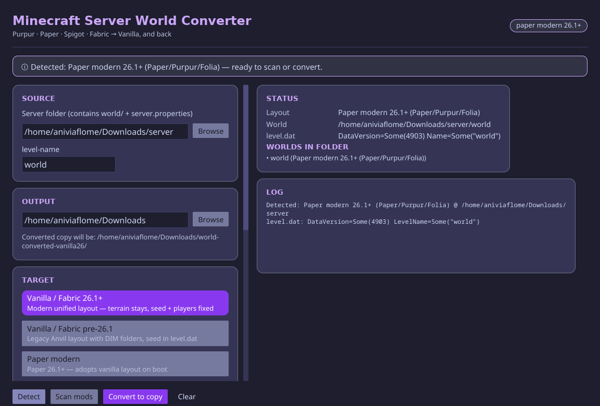

# mcsc — Minecraft Server World Converter

Iced GUI that converts server worlds between layouts (Paper/Purpur/Spigot/Fabric ↔ Vanilla), with offline→online player remap and a report-only modded-content scan.



## Run

```sh
nix run github:AniviaFlome/mcsc
```

Defaults: backup on, dry-run off, copy mode (source untouched). Output lands next to the server folder, never inside it.

## Layouts

| Layout | Overworld | Nether | End |
|---|---|---|---|
| Vanilla / Fabric 26.1+ | `dimensions/minecraft/overworld/{region,entities,poi}` | same tree (`the_nether`) | same tree (`the_end`) |
| Paper modern 26.1+ | same tree as vanilla 26.1+ (plus Bukkit markers) | same | same |
| Vanilla pre-26.1 | `<level>/region` | `<level>/DIM-1` | `<level>/DIM1` |
| Legacy split | `<level>/` | `<level>_nether/DIM-1` | `<level>_the_end/DIM1` |

Offline-mode servers store players under v3 UUIDs; auto-remap (on by default) pairs every known username to its online v4 UUID via `usercache.json`/ops/whitelist plus lookup, copying `playerdata`/`stats`/`advancements` so inventories survive.
